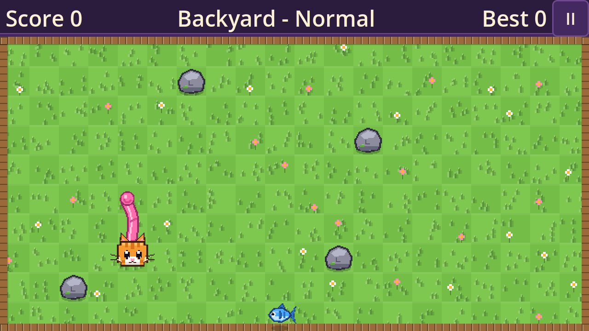
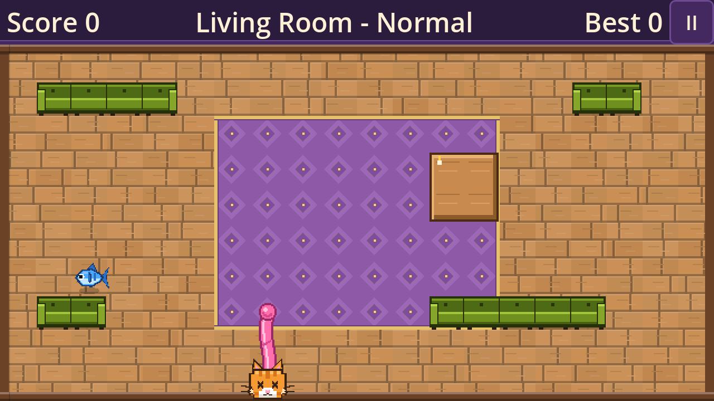
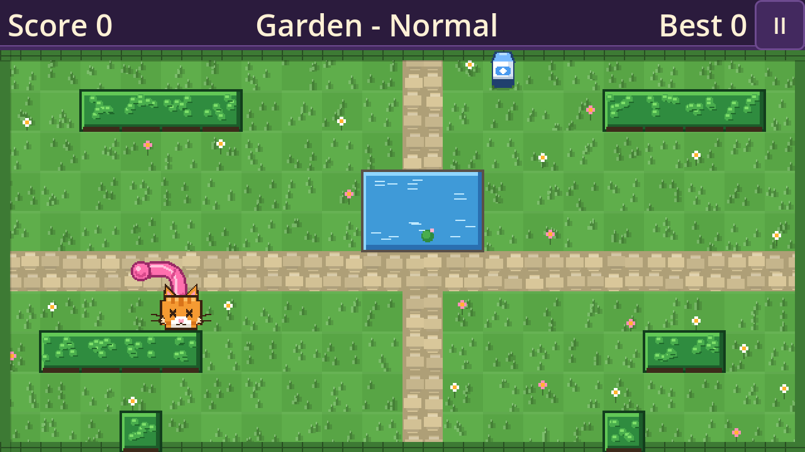
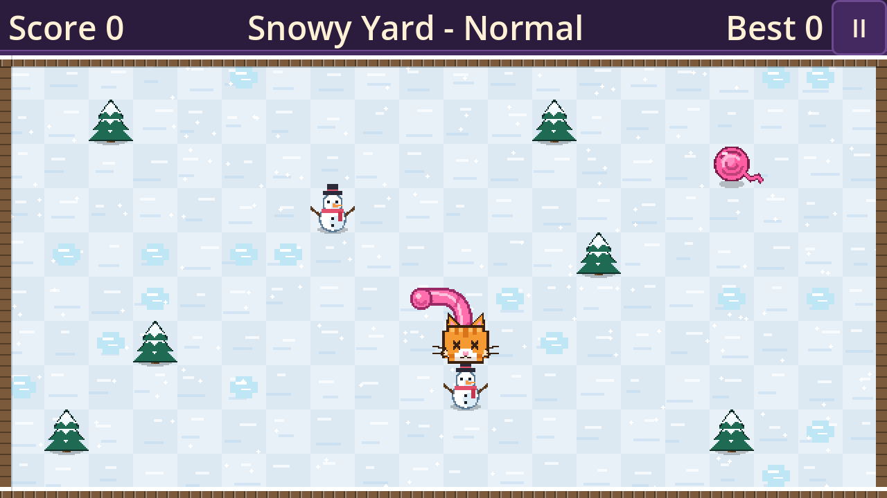
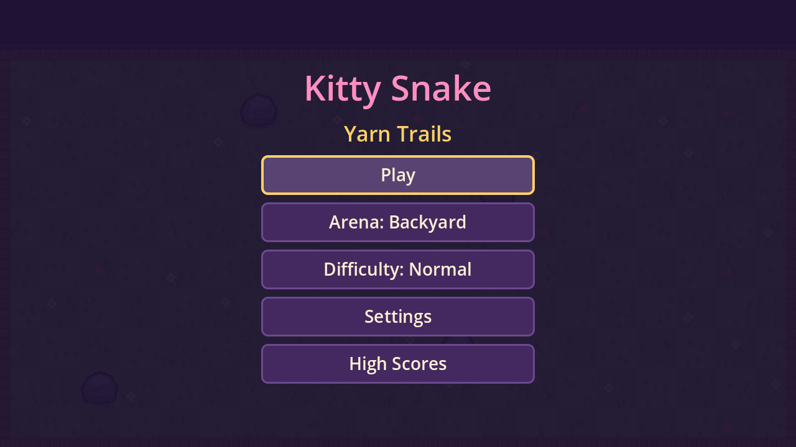
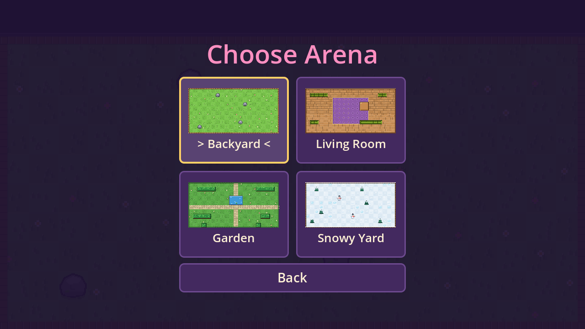

# 🐱 Kitty Snake: Yarn Trails

A colorful, retro-style **Snake** game starring a kitten. Collect fish, milk, yarn balls and golden fish while a pink yarn trail grows behind you — don't tie yourself in knots!

Built with **Godot 4.3** as **one shared codebase** exported to **Web (HTML5)**, **Windows** and **Android**. Fully offline, single-player, no ads, no accounts, no tracking.

| Backyard | Living Room |
|---|---|
|  |  |

| Garden | Snowy Yard |
|---|---|
|  |  |

| Title | Arena select |
|---|---|
|  |  |

> All art and sound are original, drawn and generated in code (16-bit style, 32px cells). Final artwork is still to come.

## Features

- Classic endless high-score mode on a 20 × 10 grid
- **4 arenas:** Backyard, Living Room, Garden, Snowy Yard (grid-aligned obstacles, themed look)
- **3 difficulties:** Easy / Normal / Hard (different speeds, speed-ups every 5 items, more obstacles on higher levels)
- **Items:** Fish (+10), Milk (+15), Yarn ball (+30, grows 3), Golden fish (+100, grows 5); Scissors power-up is implemented but disabled by a data flag
- Smooth interpolated, wiggling yarn trail (visual only; collisions are strictly grid-based) with a **Reduce Motion** option
- Separate high scores per arena and difficulty, saved locally
- Keyboard, gamepad, on-screen D-pad and swipe controls
- Pause, restart, 3-2-1 countdown; auto-pauses when the app loses focus

## Controls

| Platform | Move | Pause / Back | Confirm |
|---|---|---|---|
| Keyboard | Arrow keys or WASD | Esc or P | Enter / Space |
| Gamepad | D-pad or left stick | Start / B | A |
| Touch (Android, mobile web) | On-screen D-pad (or swipe — see Settings) | Pause button | Tap |

## Download / play

Builds are produced by GitHub Actions on every push.

1. Open the **Actions** tab → latest successful **Build** run.
2. Download an artifact from the bottom of the run page:
   - `kitty-snake-web` — HTML5 build
   - `kitty-snake-windows` — Windows x86_64 zip
   - `kitty-snake-android-debug` — Android debug APK

**Web:** unzip and serve over HTTP (it will not work from `file://`):
```bash
cd kitty-snake-web && python3 -m http.server 8080   # then open http://localhost:8080
```
**Windows:** unzip and run `KittySnake.exe` (keep the `.pck` next to it). The build is unsigned, so SmartScreen may warn about an unknown publisher.

**Android:** copy the APK to your phone, open it and allow "install unknown apps". It is a debug-signed build for testing.

> **Status:** all three targets build in CI and the core game logic is covered by automated tests. The Web build has been smoke-tested in a browser; the Windows and Android builds have not yet been tested on real devices. iOS is intentionally not supported (it needs a paid Apple Developer account and a Mac).

## Build from source

Requirements: **Godot 4.3-stable** and its matching export templates (https://github.com/godotengine/godot/releases/tag/4.3-stable). Android additionally needs JDK 17 and the Android SDK (build-tools 34, platform 34).

```bash
git clone https://github.com/comarcat/Kitty-Snake.git && cd Kitty-Snake
godot --headless --path . --import        # first time only
godot --path .                            # run the game (or open the folder in the Godot editor and press F5)

tools/export.sh web                       # -> builds/web/index.html
tools/export.sh windows                   # -> builds/windows/, builds/KittySnake-windows.zip
tools/export.sh android-debug             # -> builds/android/KittySnake-debug.apk
```

Full export notes (signing, AAB, package ID, hosting): [`docs/build-and-export.md`](docs/build-and-export.md).

## Tests

```bash
godot --headless --path . --import
godot --headless --path . --script tests/run_tests.gd
```
46 headless checks cover movement, turn buffering, growth, tail and collision rules, item spawning, deterministic replays, arena validation, save-file recovery, reduce-motion, pause and smooth-motion (no jumps or stalls at 60 FPS). Manual checklist: [`docs/test-plan.md`](docs/test-plan.md).

## Project layout

```
scripts/core/         pure, deterministic grid simulation (no rendering or input)
scripts/controllers/  game flow, countdown, pause, input adapter
scripts/rendering/    kitten, yarn, arenas, items (procedural pixel art)
scripts/services/     save (versioned JSON) and procedural audio
scripts/ui/           menus, HUD, touch controls, layout
data/                 arenas (ASCII maps), items, difficulties — edit these to tweak the game
tests/                headless test runner
docs/                 architecture, build/export, test plan, asset guidelines
tools/                export and local-serve helper scripts
```

Design notes: [`docs/architecture.md`](docs/architecture.md). Adding or changing arenas only needs a new JSON map in `data/arenas/` (legend in `scripts/core/arena_data.gd`); tests validate every arena automatically.

## Roadmap

- Final kitten and arena artwork, music and logo
- Real-device testing on Windows and Android; release signing / Play Store AAB
- Optional extras after the MVP: scissors power-up enabled, more arenas, time-attack mode

## License and credits

Game code, data and art are original to this project. Built with [Godot Engine](https://godotengine.org) (MIT). See [`LICENSES.md`](LICENSES.md).
